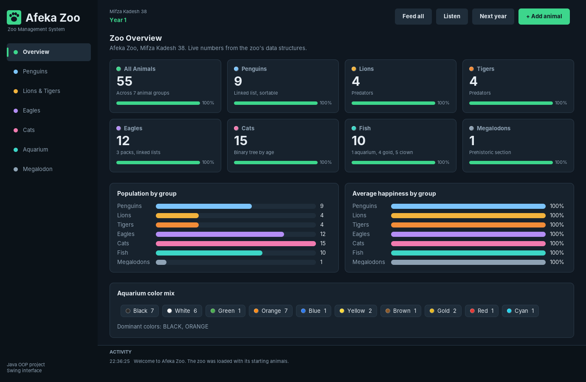
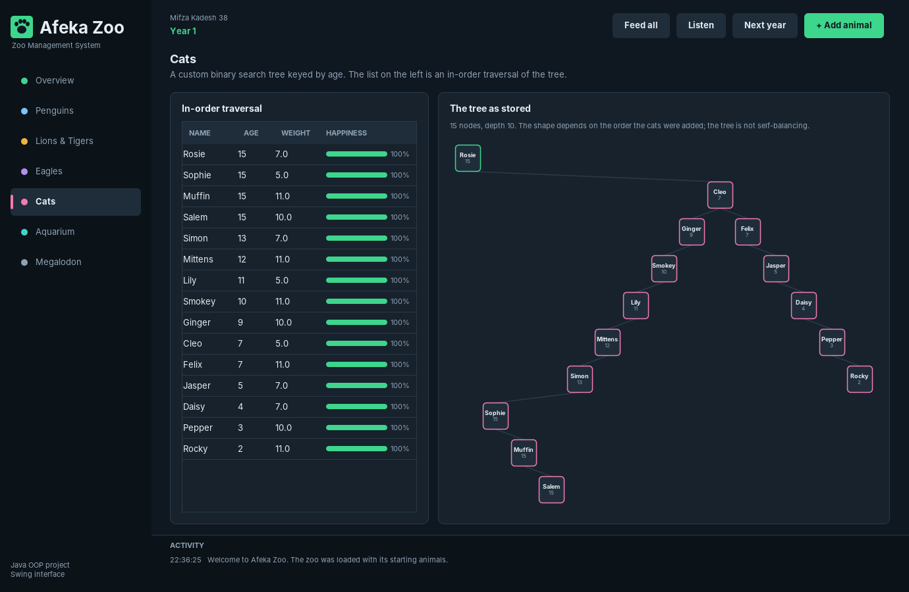
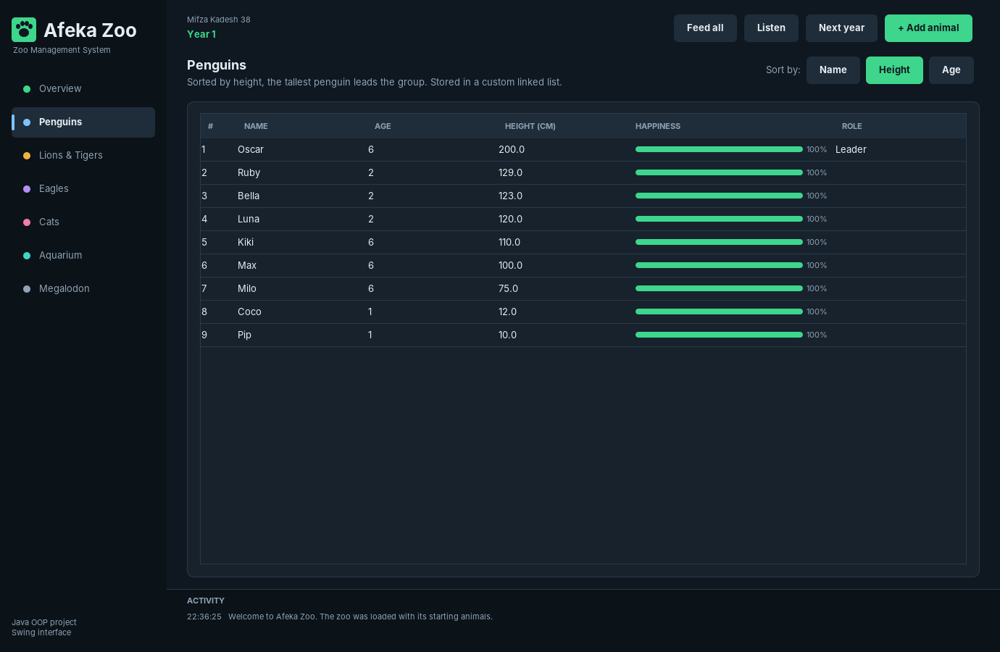
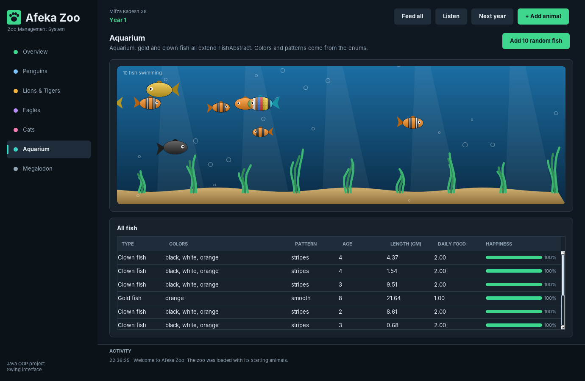
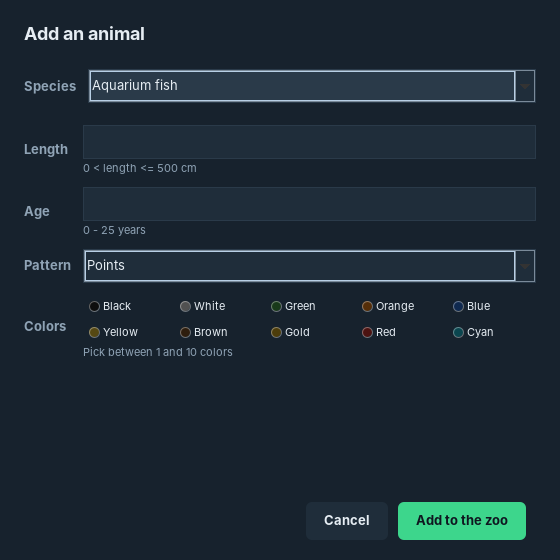

# Zoo Management System

A Java zoo simulation built around **object-oriented design**: class hierarchies, interfaces, polymorphism, enums, custom comparators and hand-written data structures. Developed as the final project of an Object-Oriented Programming course, and later extended with a **Swing dashboard**.



---

## About

The zoo is home to penguins, lions, tigers, eagles, cats, three kinds of fish and a megalodon. You can add animals, feed them, listen to them and move the simulation forward year by year.

Every year each animal ages and loses some happiness. Feeding brings it back to 100%, and an animal leaves the zoo when it passes its life span or its happiness drops to zero.

The project has two front ends that share the same model:

- **Console application** (`zoo.ZooAplication`): the original text menu.
- **Swing dashboard** (`gui.ZooDashboard`): a graphical interface that works only through `ZooInterface`, so every number on screen comes from the project's own classes and data structures.

---

## Object-Oriented Design

| Concept | Where it appears |
|---|---|
| **Inheritance** | `AnimalAbstract` → `PredatoryAnimalsAbstract` → `PredatoryBird` → `Eagle`, and `AnimalAbstract` → `FishAbstract` → aquarium, gold and clown fish |
| **Interfaces** | A shared animal interface (`feed`, `ageOneYear`, `makeNoise`), one interface per data structure, and `ZooInterface`, which both front ends depend on |
| **Polymorphism** | Feeding and listening call each animal's own `feed()` and `makeNoise()` |
| **Enums** | Eagle types, fish colors and fish body patterns |
| **Comparators** | Sorting by age, name, speed and top altitude, chained for the eagle packs |
| **Singleton** | The zoo is created once through `Zoo.getZooInstance` |
| **Custom exceptions** | `ExceptionZoo`, with a title and a description, rejects invalid animals |

---

## Hand-Written Data Structures

- **Cats: binary search tree** keyed by age. The dashboard draws the tree exactly as it is stored, next to its in-order traversal. The tree is not self-balancing, so its shape depends on the order the cats were added.
- **Penguins: sorted linked list.** The sorting strategy can be switched at runtime between name, height and age.
- **Eagles: three linked lists**, one pack per eagle type, each ordered by speed, then age, then top altitude.

<table>
  <tr>
    <td></td>
    <td></td>
  </tr>
  <tr>
    <td align="center"><sub><b>The cats' binary search tree, drawn as stored</b></sub></td>
    <td align="center"><sub><b>The penguin linked list, sortable at runtime</b></sub></td>
  </tr>
</table>

---

## The Swing Dashboard

Built with Swing and custom Java2D drawing, with no external libraries.

- A screen for every animal group: overview, penguins, lions and tigers, eagles, cats, aquarium and megalodon.
- **Feed all**, **Listen**, **Next year** and **Add animal** actions in the top bar.
- An **animated aquarium** where every fish is drawn with its own colors, body pattern and size.
- An **add-animal form** that uses the same limits and constructors as the console version, so invalid input is rejected with the project's `ExceptionZoo` messages.
- A built-in **screenshot mode** that saves an image of every screen.

<table>
  <tr>
    <td></td>
    <td></td>
  </tr>
  <tr>
    <td align="center"><sub><b>The animated aquarium</b></sub></td>
    <td align="center"><sub><b>Adding an animal with validation</b></sub></td>
  </tr>
</table>

---

## Project Structure

```
src/
├── abstract_classes/      # Abstract base classes (AnimalAbstract, FishAbstract, ...)
├── animals/               # Animal implementations (Cat, Lion, Penguin, ...)
├── comporators/           # Custom comparators for sorting
├── enums/                 # Fish colors, fish body patterns and eagle types
├── interfaces/            # Interfaces for animal behavior, collections and the zoo
├── sorting_strategics/    # Data structures (binary search tree, linked lists)
├── zoo/                   # Zoo logic, exceptions and the console application
└── gui/                   # Swing dashboard (uses only ZooInterface)
```

---

## Getting Started

Requires **JDK 17 or higher**.

**In an IDE** (IntelliJ IDEA, Eclipse or VS Code with the Extension Pack for Java), open the project folder and run:

- `src/gui/ZooDashboard.java` for the dashboard, or
- `src/zoo/ZooAplication.java` for the console version.

**From the command line**, in the project folder:

```bash
# Compile
javac -d out -sourcepath src src/zoo/ZooAplication.java src/gui/ZooDashboard.java

# Run the dashboard
java -cp out gui.ZooDashboard

# Run the console version
java -cp out zoo.ZooAplication

# Save a screenshot of every dashboard screen
java -cp out gui.ZooDashboard --screenshots screenshots
```

---

## Recent Improvements

Alongside the dashboard, several bugs in the original code were reproduced and fixed:

- Moving to the next year could crash with a `NullPointerException` when an eagle left the zoo before the penguins had ever been re-sorted.
- Choosing an invalid penguin sorting option removed every penguin from the list.
- Cats that left because of low happiness were reported as removed but stayed in the tree.
- Predators' daily food was calculated once and never updated as they aged.
- The aquarium's color list could skip colors that were present.
- Subclasses that redeclared fields such as `happiness` and `color` now use the single field in their base class.

---

## License

Released under the [MIT License](LICENSE).
